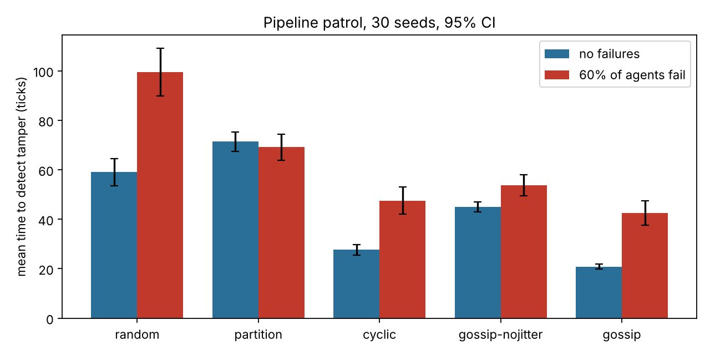
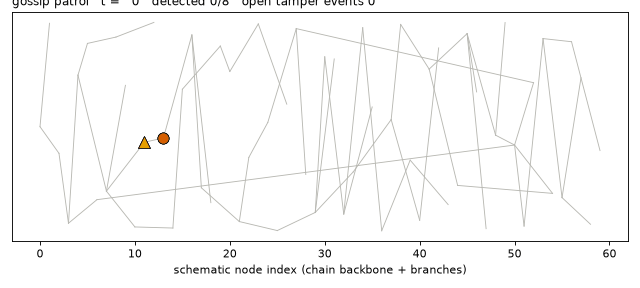

# pipeline-patrol-swarm


Decentralized patrol of a pipeline network by a **mixed fleet** (2 fast, endurance-limited
UAVs + 3 slow, unlimited UGVs) under **tamper events** and **agent failures**. Simulation only.
Motivated by pipeline/grid-asset protection in Nigeria, but the network is synthetic.



## Setup
60-node network (long backbone, branches, 3 loops), depot at the graph centre. UAV: speed 3,
120 distance units of endurance, 20-tick recharge at the depot. UGV: speed 1. 40 tamper events
per run at random nodes/times; an event is detected at the first inspection of its node.
Failures: each agent fails once with the stated probability. Policies: `random`, `partition`
(static split by node, per-agent tour), `cyclic` (one shared tour, staggered), `gossip`
(decentralized idleness-greedy from a local last-visit map merged by gossip within range 6, with
target claims).

## Results (30 seeds, mean ± 95% CI; `results/summary.md`)
| policy | agent failures | mean time-to-detect | p95 TTD (censored) | undetected |
|---|---|---|---|---|
| partition | none | 71.4 ± 3.9 | 151 ± 6 | 0.0% |
| partition | 60% | 69.1 ± 5.3 | 981 ± 306 | **34.8%** |
| cyclic | none | 27.7 ± 2.1 | 84 ± 7 | 0.0% |
| cyclic | 60% | 47.6 ± 5.4 | 152 ± 51 | 1.2% |
| gossip | none | **20.8 ± 1.1** | **55 ± 3** | 0.0% |
| gossip | 60% | 42.6 ± 5.0 | 153 ± 75 | 1.4% |

Findings, stated carefully:
1. **Static partitioning is fragile**: when agents die, their nodes are never covered (35% of events never found).
2. Without failures, gossip beats the cyclic tour (20.8 vs 27.7, CIs do not overlap). With failures,
   gossip and cyclic are **statistically indistinguishable** (42.6 ± 5.0 vs 47.6 ± 5.4).
3. **A herding bug found by ablation.** My first gossip policy was *worse* than the cyclic tour (45.0), and
   oddly got *better* when messages were dropped. Hypothesis: agents with identical shared beliefs pick the same
   target. Adding small random noise to the target score fixed it (45.0 -> 20.8). The ablation row
   `gossip-nojitter` is kept in `results/summary.md`.
4. **Communication adds little here**: with all messages dropped (`gossip-loss1.0`) the mean
   is 22.6 ± 1.6 vs 20.8 ± 1.1 with full gossip; the intervals nearly overlap. So the benefit comes
   mainly from local idleness-greedy choice, not from sharing.

## Limitations
* Synthetic network, uniform event locations; no hotspot/risk weighting, no sensing errors.
* Distance penalty β=1 and jitter=10 were tuned on separate seeds (1000-1009), reported seeds are 0-29; the
  jitter fix was found after seeing the first results.
* Failure is not detected explicitly; `partition` has no re-partitioning (a stronger baseline would).
* Comm range uses the agent's last node, not its position on an edge.
* p95 TTD treats undetected events as censored at the horizon.

## Reproduce
```bash
pip install numpy matplotlib pytest
PYTHONPATH=src python -m pytest -q tests          # 12 passed
python experiments/run_experiments.py && python experiments/summarize.py && python experiments/make_figures.py
```
MIT licensed.


## Simulated animation

[](figures/demo_patrol.gif)

*Gossip patrol with tamper events and agent positions. Regenerate with `python experiments/make_animation.py`; the frames are produced by this project's own simulator.*


## How this connects

Application rung of the same ladder as [`stc-corridors`](https://github.com/olamida/stc-corridors); uses decentralized ideas related to [`mesh-routing-sim`](https://github.com/olamida/mesh-routing-sim).

## Portfolio documentation

- [`APP-GUIDE.md`](APP-GUIDE.md) — work executed and work still to do.
- [`USER-GUIDE.md`](USER-GUIDE.md) — end-user manual.
- [`PENDING-TASKS.md`](PENDING-TASKS.md) — AI session-continuity ledger.
- [`SYSTEM-DOCUMENTATION.md`](SYSTEM-DOCUMENTATION.md) — developer/architecture reference.
